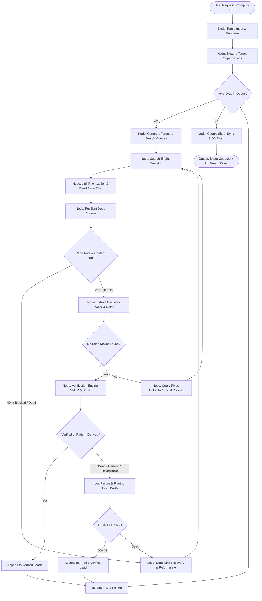
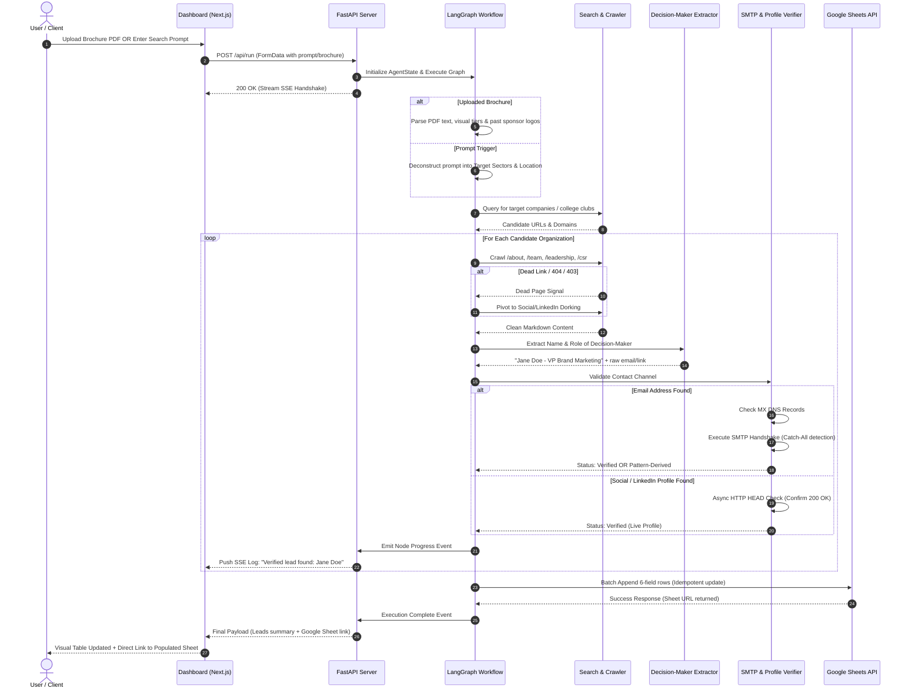

# Project Architecture: Autonomous Lead Discovery & Verification Agent

## 1. Executive Summary & System Objectives

The **Autonomous Lead Discovery & Verification Agent** is an end-to-end intelligent pipeline built with **LangGraph** designed to automate the discovery, extraction, verification, and database ingestion of high-intent B2B sponsors and collegiate delegations for events.

Targeting the core bottleneck of manual outreach—where contact information is hidden behind generic mailboxes (`info@`, `contact@`) or rendered outdated across broken web pages—this system operates autonomously from a natural language query or an uploaded event brochure (PDF) down to a verified, populated Google Sheet.

### Scoring Criteria Alignment (100-Point Target)
| Evaluation Metric | Max Pts | Architectural Guarantee |
| :--- | :--- | :--- |
| **Agent Flow & Autonomy** | 40 | Self-directed LangGraph state machine with dynamic link crawling, query reformulation, automatic dead-page failover, and retry cycles. |
| **Contact Accuracy** | 30 | Multi-stage verification pipeline (RFC syntax, DNS MX validation, real-time socket SMTP handshakes with catch-all mitigation, and social profile HEAD checks). Strict zero-hallucination guardrails. |
| **Brochure / PDF Parsing** | 15 | Hybrid extraction engine combining visual layout analysis, PyMuPDF structured text parsing, and LLM semantic entity resolution. |
| **End-to-End Pipeline** | 15 | Hands-free ingestion from initial trigger to live Google Sheet batch synchronization and local SQLite persistence with audit logging. |

---

## 2. Technology Stack & Technical Rationale

```
+---------------------------------------------------------------------------------------+
|                                    PRESENTATION LAYER                                 |
|      Next.js 14 / React 18 (App Router) + Tailwind CSS + shadcn/ui + Lucide Icons     |
+---------------------------------------------------------------------------------------+
                                           | HTTP / SSE Stream
+---------------------------------------------------------------------------------------+
|                                  APPLICATION API LAYER                                |
|                FastAPI (Python 3.11+) + Uvicorn + SSE Streaming Protocol              |
+---------------------------------------------------------------------------------------+
                                           |
+---------------------------------------------------------------------------------------+
|                               AGENTIC ORCHESTRATION LAYER                             |
|               LangGraph 0.2+ (StateGraph, Checkpointing, Dynamic Routing)             |
|                  LangChain Core + Pydantic v2 (Strict Schema Enforcement)              |
+---------------------------------------------------------------------------------------+
         |                                |                                 |
+-------------------+           +-------------------+             +--------------------+
| DOCUMENT & VISION |           | SEARCH & SCRAPING |             | VERIFICATION CORE  |
| - PyMuPDF (fitz)  |           | - Tavily / Serper |             | - aiosmtplib       |
| - pdfplumber      |           | - Crawl4AI / Playwright         | - dnspython (DNS)  |
| - Vision LLM OCR  |           | - Trafilatura     |             | - httpx (Async)    |
+-------------------+           +-------------------+             +--------------------+
                                           |
+---------------------------------------------------------------------------------------+
|                               PERSISTENCE & EXPORT LAYER                              |
|           Google Sheets API (gspread + OAuth/SA) + SQLite (SQLAlchemy / aiosqlite)   |
+---------------------------------------------------------------------------------------+
```

### Detailed Component Selection
1. **Agentic Orchestration: LangGraph (`langgraph >= 0.2.20`)**
   - *Rationale:* Lead hunting requires non-linear cycles: query $\to$ search $\to$ crawl $\to$ extract $\to$ verify $\to$ retry if dead or unverified $\to$ export. Standard DAGs (e.g., vanilla LangChain chains) cannot handle self-correcting retry loops and conditional branching. LangGraph provides cyclical state management, interruptible execution, and state persistence.
2. **Search & Link Harvesting: Tavily Search API + Serper (Google Search)**
   - *Rationale:* Tavily provides LLM-optimized web results and raw page links. Serper/Google provides targeted Dorking capabilities (e.g., `site:linkedin.com/in/ "VP Marketing" "Company"`).
3. **Deep Web Crawling: Crawl4AI + Trafilatura + Playwright**
   - *Rationale:* Modern corporate and student society sites use Single Page Applications (React, Next.js, Webflow). Trafilatura provides lightning-fast heuristic markdown extraction for static pages, while Crawl4AI/Playwright handles dynamic JavaScript rendering, cookie walls, and complex DOMs.
4. **LLM Reasoning & Extraction: OpenAI (`gpt-4o` / `gpt-4o-mini`) / Anthropic Claude 3.5 Sonnet**
   - *Rationale:* Utilizes native structured outputs (`response_format={"type": "json_schema"}`) via Pydantic v2 to strictly forbid hallucinated schema alterations.
5. **Contact Deliverability & Verification Engine:**
   - `dnspython`: Resolves high-priority MX (Mail Exchange) server records.
   - `aiosmtplib`: Performs non-intrusive asynchronous SMTP `HELO/EHLO` $\to$ `MAIL FROM` $\to$ `RCPT TO` handshake sequences without dispatching emails. Detects server catch-alls.
   - `httpx`: High-throughput async client verifying social profile links (LinkedIn, Instagram, Facebook, University domain pages) via HTTP `HEAD` / `GET` status codes.
6. **Data Storage & Sync: Google Sheets API (`gspread`) + SQLite**
   - *Rationale:* `gspread` provides batched cell updates to avoid Google quota limits (300 requests/min). SQLite serves as a local atomic caching layer to guarantee idempotency and offline replayability.

---

## 3. Strict 6-Field Output Schema & Data Models

The system enforces the exact 6-field output table required by the specification:

| Field Name | Type | Allowed Values / Format | Description |
| :--- | :--- | :--- | :--- |
| **Organization Name** | `string` | Free text (Cleaned) | Name of the target company or collegiate society. |
| **Category** | `enum` | `"Sponsor"` \| `"College Delegation"` | Categorization of the outreach target. |
| **Location** | `string` | City or City, Country | Headquarter or collegiate chapter base city. |
| **Contact Person** | `string` | `"[Full Name] - [Job Title]"` | Individual decision-maker (e.g., "Sarah Connor - VP Marketing"). Generic emails/departments prohibited. |
| **Contact Channel** | `string` | Email address or authentic profile URL | Verified email (`sarah@acme.com`) or live profile (`https://linkedin.com/in/sarahc`). |
| **Verification Status**| `enum` | `"Verified"` \| `"Pattern-Derived"` | Method of verification. Hallucinated/unverified entries are eliminated. |

### Pydantic Model Hierarchy (`src/models/schema.py`)

```python
from enum import Enum
from typing import List, Optional
from pydantic import BaseModel, Field, HttpUrl, EmailStr

class CategoryEnum(str, Enum):
    SPONSOR = "Sponsor"
    COLLEGE_DELEGATION = "College Delegation"

class VerificationStatusEnum(str, Enum):
    VERIFIED = "Verified"
    PATTERN_DERIVED = "Pattern-Derived"

class DecisionMakerRole(BaseModel):
    name: str = Field(..., description="Full personal name of the decision maker")
    title: str = Field(..., description="Corporate role or society leadership title")
    linkedin_url: Optional[str] = Field(None, description="Direct personal profile link")

class RawContactData(BaseModel):
    organization_name: str
    category: CategoryEnum
    location: str
    decision_maker: DecisionMakerRole
    email_candidate: Optional[str] = None
    profile_url_candidate: Optional[str] = None
    source_url: str
    raw_snippet: str

class FinalLeadRecord(BaseModel):
    organization_name: str = Field(..., alias="Organization Name")
    category: CategoryEnum = Field(..., alias="Category")
    location: str = Field(..., alias="Location")
    contact_person: str = Field(..., alias="Contact Person", description="Formatted as 'Name - Role'")
    contact_channel: str = Field(..., alias="Contact Channel", description="Deliverable email or verified profile link")
    verification_status: VerificationStatusEnum = Field(..., alias="Verification Status")

    class Config:
        populate_by_name = True
```

---

## 4. LangGraph Multi-Agent Architecture & State Flow

The system runs as an autonomous state machine with self-correcting feedback loops.

### State Definition (`AgentState`)
```python
from typing import TypedDict, List, Dict, Any, Annotated
import operator

class AgentState(TypedDict):
    # Inputs
    search_prompt: Optional[str]
    brochure_path: Optional[str]
    category_focus: Optional[str]
    
    # Brochure Extraction
    brochure_entities: List[Dict[str, Any]]
    
    # Discovery & Link Queues
    target_organizations: List[Dict[str, Any]]
    active_org_index: int
    search_queries: List[str]
    candidate_urls: List[str]
    visited_urls: Annotated[List[str], operator.add]
    dead_urls: Annotated[List[str], operator.add]
    
    # Candidate Extraction
    extracted_candidates: List[Dict[str, Any]]
    
    # Verification Pipeline
    verified_leads: Annotated[List[Dict[str, Any]], operator.add]
    rejected_leads: Annotated[List[Dict[str, Any]], operator.add]
    
    # Retry & Autonomy Controls
    retry_count: int
    max_retries: int
    is_complete: bool
    
    # Execution Logs for UI
    logs: Annotated[List[str], operator.add]
```

### Graph Execution Diagram



---

## 5. File Directory Structure

```
CQ_Scraper/
│
├── problem-statement.pdf               # Original specification document
├── Project_Architecture.md             # This document (High-level architecture)
├── Implementation roadmap.md           # Sequential phase roadmap with micro-tasks
├── spec_scraper.md                     # Technical spec for core modules
├── Ai_Prompt_guidelines.md             # Strict coding & hallucination prevention rules
├── Design.md                           # Modern dashboard UI design guidelines
│
├── .env.example                        # Template for API keys and environment variables
├── requirements.txt                    # Python dependencies
├── pyproject.toml                      # Project metadata, linters, and build config
├── README.md                           # Quickstart and run instructions
│
├── config/
│   ├── __init__.py
│   ├── settings.py                     # Pydantic BaseSettings (Keys, limits, timeouts)
│   └── google_credentials.json.example # Service account configuration sample
│
├── src/
│   ├── __init__.py
│   │
│   ├── models/                         # Domain schemas & Pydantic definitions
│   │   ├── __init__.py
│   │   ├── schema.py                   # Final 6-field schema & intermediate data models
│   │   └── state.py                    # LangGraph TypedDict state definitions
│   │
│   ├── parsers/                        # Input & Brochure processing
│   │   ├── __init__.py
│   │   ├── brochure_parser.py          # PyMuPDF + pdfplumber + Vision OCR brochure extractor
│   │   └── prompt_expander.py          # Query analyzer & target entity generator
│   │
│   ├── search/                         # Search & Dorking engine
│   │   ├── __init__.py
│   │   ├── search_client.py            # Serper / Tavily / DuckDuckGo fallback client
│   │   └── query_generator.py          # Contextual query reformulation & Dork builder
│   │
│   ├── crawler/                        # Resilient Web Crawler
│   │   ├── __init__.py
│   │   ├── deep_crawler.py             # Trafilatura + Crawl4AI dynamic DOM extractor
│   │   ├── link_prioritizer.py         # Priority scoring for /team, /about, /executives
│   │   └── resilience.py               # Dead-page handling, exponential backoff, user-agent rotation
│   │
│   ├── extractors/                     # Entity & Role extraction
│   │   ├── __init__.py
│   │   ├── decision_maker.py           # Persona extractor (VP, CSR, Society President)
│   │   └── pattern_engine.py           # Email format pattern deriving engine (first.last@domain)
│   │
│   ├── verifier/                       # Verification subsystem
│   │   ├── __init__.py
│   │   ├── syntax_check.py             # RFC-5322 compliance validator
│   │   ├── mx_resolver.py              # DNS MX record resolver & priority sorter
│   │   ├── smtp_handshake.py           # Non-intrusive socket SMTP verification & catch-all tester
│   │   └── social_validator.py         # HTTP HEAD/GET live status checker for LinkedIn/Insta
│   │
│   ├── graph/                          # LangGraph state machine implementation
│   │   ├── __init__.py
│   │   ├── nodes.py                    # Individual functional nodes
│   │   ├── edges.py                    # Conditional routers & termination criteria
│   │   └── lead_graph.py               # Compiled StateGraph workflow builder
│   │
│   ├── storage/                        # Persistence & Sync
│   │   ├── __init__.py
│   │   ├── database.py                 # SQLite local database & run cache
│   │   └── google_sheets.py            # gspread batch syncer with format styling
│   │
│   └── api/                            # FastAPI Server & Streaming
│       ├── __init__.py
│       ├── app.py                      # FastAPI application instance
│       ├── routes.py                   # Endpoints: /api/run, /api/status, /api/export
│       └── stream.py                   # SSE Event generator for real-time progress
│
├── frontend/                           # Modern Dashboard UI (Next.js 14)
│   ├── package.json
│   ├── tailwind.config.js
│   ├── tsconfig.json
│   ├── app/
│   │   ├── layout.tsx                  # Global theme & typography provider
│   │   ├── page.tsx                    # Main interactive agent control center
│   │   └── api/proxy/route.ts          # Backend streaming bridge
│   ├── components/
│   │   ├── brochure-upload.tsx         # Drag-and-drop PDF dropzone
│   │   ├── search-input.tsx            # Natural language query input with suggestions
│   │   ├── live-agent-feed.tsx         # Real-time node transition & terminal log
│   │   ├── leads-table.tsx             # 6-column interactive table with badges
│   │   └── stats-bar.tsx               # Metric cards (Found, Verified, Rate, Sheet Link)
│   └── lib/
│       └── utils.ts
│
└── tests/                              # Comprehensive test suite
    ├── __init__.py
    ├── test_brochure_parser.py
    ├── test_decision_maker.py
    ├── test_verifier.py
    └── test_graph_flow.py
```

---

## 6. End-to-End Component Interactions & Data Flow

### Sequence Flow: Prompt / PDF to Verified Row Sync


---

## 7. Security, Rate Limiting & Resilience Architecture

1. **Anti-Bot & Rate-Limit Resilience:**
   - Crawling employs polite delays (1.0–2.5s jittered sleep).
   - Rotating HTTP headers using standard desktop user agents.
   - Dynamic fallbacks from lightweight HTTP fetches (`httpx`) to headless browsers (`Crawl4AI` / `Playwright`) only when dynamic JavaScript execution or challenge pages are detected.
2. **SMTP Verification Safety (Anti-Blacklist Protection):**
   - No emails are ever sent. Socket connections cleanly terminate immediately following the `RCPT TO` response (`RSET` then `QUIT`).
   - Domain-level rate limiting prevents hammering a single corporate mail exchange server.
   - Automatic detection of catch-all domains (domains that return `250 OK` for randomized non-existent prefixes like `xyq987asdf@domain.com`).
3. **Data Protection & Credentials:**
   - All Google Service Account keys and Search API credentials are kept out of source control using `.env` validation via `pydantic-settings`.
